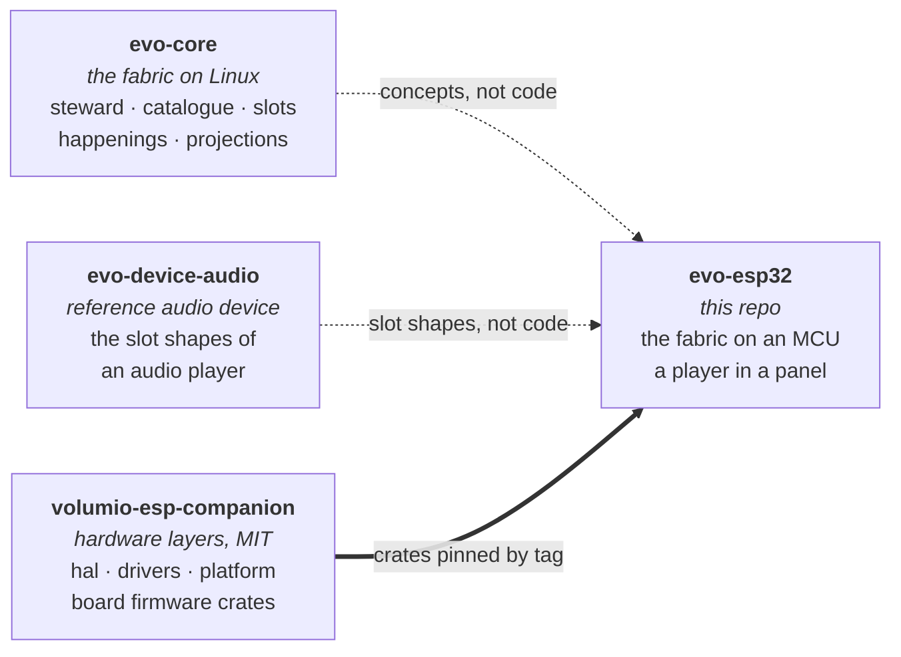

# evo-esp32

> The evo fabric on a microcontroller. A standalone music player on an
> ESP32 touch panel, built the way an evo device is built: a declared
> catalogue, slots stocked by plugins, one steward that owns the state.

evo™ and evoframework™ are trademarks of Just a Nerd. The fabric in
this repository is licensed under the Business Source License 1.1
(see `LICENSE`); the surface others implement against is licensed
under the Apache License, Version 2.0 (see the `LICENSE` file in each
such crate's directory). See `TRADEMARK.md` for the trademark policy
and `CONTRIBUTING.md` for the contribution flow (DCO sign-off
required).

**Where the project stands.** Concept. Nothing builds yet. The
hardware layers it will stand on are being brought up in
[volumio-esp-companion](https://github.com/foonerd/volumio-esp-companion);
code lands here once that project has lit a panel. The
[wiki](https://github.com/foonerd/evo-esp32/wiki) has the
[hardware](https://github.com/foonerd/evo-esp32/wiki/Hardware) the
first device will need.

## How it fits together

evo-core is a fabric for Linux appliances: one long-running steward
process administers a declared catalogue, admits plugin processes that
stock its slots, and emits projections and happenings over a socket.
Nothing of that runs on a microcontroller as it stands. What does carry
is the shape: the catalogue as the description of the device, plugins
that stock slots and never address each other, the steward as the sole
authority over state, projections as the only thing a consumer reads.
This repository takes that shape onto an ESP32 and finds out which
parts of the fabric survive the move and which have to be reinvented.

The hardware is not written here. The pins, the bring-up, the display,
the touch controller, the IO expander, Wi-Fi, the configuration store
and the HTTP client are the companion project's `hal`, `drivers`,
`platform` and `firmware` crates, consumed by tag. This repository
writes the application: the catalogue, the steward, the plugins that
make a panel a player.

## What this repository will contain

| Part | Holds |
| --- | --- |
| `catalogue/` | The declared device: racks, shelves, slots. Resolved at build time; a firmware image is one catalogue. |
| `steward/` | The in-process steward: admits the plugin crates the catalogue names, owns the subjects, emits happenings, serves projections to the panel and to one network client protocol. |
| `sdk/` | The slot contracts and the types a plugin implements. Apache-2.0. |
| `plugins/` | Brand-neutral plugins for the audio domain on an MCU: sources (TF card, HTTP radio), decode, delivery over I2S, metadata, artwork, presentation on the panel. |
| `firmware/` | One crate per board, each a distribution: the catalogue it ships, the plugins it stocks, the board crate it stands on. |

None of it exists yet. The layout is the intent; it changes when the
first lit panel shows what the MCU allows.

## Related

- [evo-core](https://github.com/foonerd/evo-core): the framework this
  takes its shape from.
- [evo-device-audio](https://github.com/foonerd/evo-device-audio): the
  reference audio device on Linux, whose slot shapes this reuses.
- [volumio-esp-companion](https://github.com/foonerd/volumio-esp-companion):
  the hardware layers this stands on, and the Volumio companion that
  shares the same boards.

## License

Business Source License 1.1 for the fabric; Apache License 2.0 for the
crates whose directories carry it. See [LICENSE](LICENSE). The licence
converts to Apache 2.0 four years after each release. For other
arrangements, open an issue titled `[licensing] ...`.
