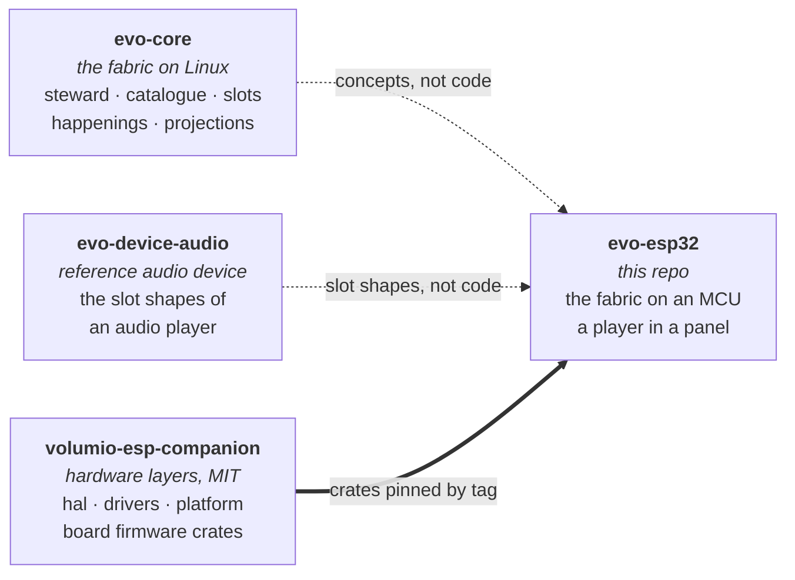

# evo-esp32

> The evo fabric on a microcontroller. A standalone music player on an
> ESP32 touch panel, built the way an evo device is built: a declared
> catalogue, slots stocked by plugins, one steward that owns the state.

evo™ and evoframework™ are trademarks of Just a Nerd. The fabric in
this repository is licensed under the Business Source License 1.1
(see `LICENSE`); the surface others implement against is licensed
under the Apache License, Version 2.0 (see the `LICENSE` file in each
such crate's directory). See `TRADEMARK.md` for the trademark policy
and `CONTRIBUTING.md` for the contribution flow (DCO sign-off
required).

**Where the project stands.** The fabric exists and runs on the host:
the SDK a plugin implements against, the steward that admits plugins,
owns subjects, composes, emits happenings and serves projections, the
catalogue tool that validates a `catalogue.toml` and checks a plugin set
stocks it, and one example plugin driven through all of it in a test.
Every crate but the catalogue tool builds for bare-metal RISC-V. No
board runs it yet; the hardware layers come from
[volumio-esp-companion](https://github.com/foonerd/volumio-esp-companion)
as they light up. The
[wiki](https://github.com/foonerd/evo-esp32/wiki) has the
[hardware](https://github.com/foonerd/evo-esp32/wiki/Hardware) the
first device will need.

## How it fits together



evo-core is a fabric for Linux appliances: one long-running steward
process administers a declared catalogue, admits plugin processes that
stock its slots, and emits projections and happenings over a socket.
Nothing of that runs on a microcontroller as it stands. What does carry
is the shape: the catalogue as the description of the device, plugins
that stock slots and never address each other, the steward as the sole
authority over state, projections as the only thing a consumer reads.
This repository takes that shape onto an ESP32 and finds out which
parts of the fabric survive the move and which have to be reinvented.

The hardware is not written here. The pins, the bring-up, the display,
the touch controller, the IO expander, Wi-Fi, the configuration store
and the HTTP client are the companion project's `hal`, `drivers`,
`platform` and `firmware` crates, consumed by tag. This repository
writes the application: the catalogue, the steward, the plugins that
make a panel a player.

## What this repository contains

| Part | Crate | Holds | Licence |
| --- | --- | --- | --- |
| `sdk/` | `evo-esp32-sdk` | The surface a plugin implements against: the catalogue types, the plugin contract, respondents and wardens, subjects, happenings, projections, the context. `no_std`. | Apache-2.0 |
| `steward/` | `evo-esp32-steward` | The sole authority: admission against the catalogue, the subject tables with per-plugin contributions, composition, a bounded happenings ring with gap-aware replay, projections by rack or subject, custody and ticking of wardens. `no_std`. | BSL 1.1 |
| `catalogue/` | `evo-esp32-catalogue` | The host tool: parse and validate `catalogue.toml`, check a plugin set stocks it, emit the catalogue as Rust for a firmware's build. | BSL 1.1 |
| `plugins/` | `org-evoframework-example-echo` | The pedagogical plugin: one shelf, one verb, one subject. | Apache-2.0 |
| `firmware/` | | One crate per board, each a distribution: the catalogue it ships, the plugins it stocks, the board crate it stands on. None yet. | BSL 1.1 |

The audio plugins (sources, decode, delivery over I2S, metadata,
artwork, presentation on the panel) and a host distribution that runs
them against a desktop audio output and a simulated panel are next.

## Build

The host workspace builds on stable Rust, pinned by `rust-toolchain.toml`.

```sh
scripts/check.sh   # format, clippy, tests, docs, no_std on bare metal, scripts, then every firmware built
cargo run -p evo-esp32-catalogue -- check plugins/org.evoframework.example.echo/catalogue.toml
```

The `no_std` claim is proved, not asserted: the check builds the SDK, the
steward and the example plugin for `riscv32imac-unknown-none-elf`, a
target with no std at all. With a firmware crate present and no ESP
toolchain on the machine, the check fails and says so.

## Related

- [evo-core](https://github.com/foonerd/evo-core): the framework this
  takes its shape from.
- [evo-device-audio](https://github.com/foonerd/evo-device-audio): the
  reference audio device on Linux, whose slot shapes this reuses.
- [volumio-esp-companion](https://github.com/foonerd/volumio-esp-companion):
  the hardware layers this stands on, and the Volumio companion that
  shares the same boards.

## License

Business Source License 1.1 for the fabric; Apache License 2.0 for the
crates whose directories carry it. See [LICENSE](LICENSE). The licence
converts to Apache 2.0 four years after each release. For other
arrangements, open an issue titled `[licensing] ...`.
