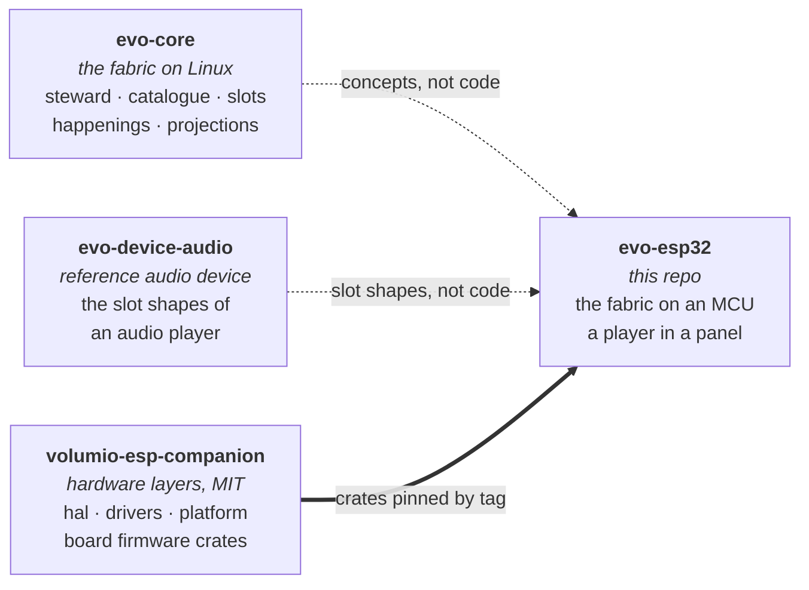

# evo-esp32

> The evo fabric on a microcontroller. A standalone music player on an
> ESP32 touch panel, built the way an evo device is built: a declared
> catalogue, slots stocked by plugins, one steward that owns the state.

evo™ and evoframework™ are trademarks of Just a Nerd. The fabric in
this repository is licensed under the Business Source License 1.1
(see `LICENSE`); the surface others implement against is licensed
under the Apache License, Version 2.0 (see the `LICENSE` file in each
such crate's directory). See `TRADEMARK.md` for the trademark policy
and `CONTRIBUTING.md` for the contribution flow (DCO sign-off
required).

**Where the project stands.** The fabric exists and runs on the host:
the SDK a plugin implements against, with the audio slot contracts typed
in; the steward that admits plugins, owns subjects, composes, emits
happenings and serves projections; the catalogue tool that validates a
`catalogue.toml` and checks a plugin set stocks it; four audio plugins
(a file source, a real decoder, a simulated one, a null output) and the
example; and a host distribution that compiles its catalogue in, decodes
FLAC, MP3 and WAV through the steward into a paced sink, bit-exact for
the lossless two, and draws the companion's face from the projections.
Every device-shaped crate builds for bare-metal RISC-V. The fabric runs
on the first board: `firmware/waveshare-esp32-c5-touch-lcd-28` brings up
the Waveshare ESP32-C5-Touch-LCD-2.8's codec and amplifier through the
companion's drivers, stands the steward and the three plugins up as the
host distribution does, and plays the music on the card through an I2S
sink paced by the I2S clock, to the board's speaker and to a Pi-HAT DAC
on its header at once, with the panel showing the face. The hardware
layers come from
[volumio-esp-companion](https://github.com/foonerd/volumio-esp-companion)
by tag. The [wiki](https://github.com/foonerd/evo-esp32/wiki) has the
[hardware](https://github.com/foonerd/evo-esp32/wiki/Hardware) the
first device needs.

## How it fits together



evo-core is a fabric for Linux appliances: one long-running steward
process administers a declared catalogue, admits plugin processes that
stock its slots, and emits projections and happenings over a socket.
Nothing of that runs on a microcontroller as it stands. What does carry
is the shape: the catalogue as the description of the device, plugins
that stock slots and never address each other, the steward as the sole
authority over state, projections as the only thing a consumer reads.
This repository takes that shape onto an ESP32 and finds out which
parts of the fabric survive the move and which have to be reinvented.

The hardware is not written here. The pins, the bring-up, the display,
the touch controller, the IO expander, Wi-Fi, the configuration store
and the HTTP client are the companion project's `hal`, `drivers`,
`platform` and `firmware` crates, consumed by tag. This repository
writes the application: the catalogue, the steward, the plugins that
make a panel a player.

## What this repository contains

| Part | Crate | Holds | Licence |
| --- | --- | --- | --- |
| `sdk/` | `evo-esp32-sdk` | The surface a plugin implements against: the catalogue types, the plugin contract, respondents and wardens, subjects, happenings, projections, the context; and the slot contracts, `contract::audio` first: the player's shelves, verbs, instructions and subject states as typed values. `no_std`. | Apache-2.0 |
| `steward/` | `evo-esp32-steward` | The sole authority: admission against the catalogue, the subject tables with per-plugin contributions, composition, a bounded happenings ring with gap-aware replay, projections by rack or subject, custody and ticking of wardens. `no_std`. | BSL 1.1 |
| `catalogue/` | `evo-esp32-catalogue` | The host tool: parse and validate `catalogue.toml`, check a plugin set stocks it, emit the catalogue as Rust for a distribution's build. | BSL 1.1 |
| `plugins/` | `org-evoframework-example-echo` | The pedagogical plugin: one shelf, one verb, one subject. | Apache-2.0 |
| | `org-evoframework-source-files` | `source/files` over a directory on a host: lists folders and audio files, announces each track as a subject. std. | Apache-2.0 |
| | `org-evoframework-source-dlna` | `source/dlna`: the DLNA (UPnP AV) media servers on the network, found by SSDP on the plugin's own thread, each listed as its tree of folders and tracks through the ContentDirectory's `Browse`, in plain std with nothing linked; a track carries its title, artist, album, duration, art and the address of its audio resource, which the decoder plays like a server's file. std. | Apache-2.0 |
| | `org-evoframework-source-smb` | `source/smb`: the SMB shares the configuration names, each a tree of folders and audio files, through a client for SMB 2.0.2 and 2.1 written in plain std (NTLMv2 under SPNEGO, HMAC-SHA256 signing when the server asks); the files are read by position, so the decoder seeks for free. The same crate is the decoder's `smb://` opener. std. | Apache-2.0 |
| | `org-evoframework-playback-sim` | `playback/decode` against the clock: custody of a track, position, pause, resume, seek, release at the end; decodes nothing. `no_std`. | Apache-2.0 |
| | `org-evoframework-playback-symphonia` | `playback/decode` for real: FLAC, MP3, WAV and PCM through [Symphonia](https://github.com/pdeljanov/Symphonia) into the distribution's `FrameSink`, a bounded slice per tick, the sink pacing; position from frames delivered; seek to the frame (coarse on MPEG audio); the stream's tags name the track. std. | Apache-2.0 |
| | `org-evoframework-delivery-null` | `delivery/output` with no sink: volume and mute on an `output` subject. `no_std`. | Apache-2.0 |
| | `org-evoframework-multiroom-receiver` | `playback/receive`: the device as a room of an Evo multiroom group. Listens on the Evo audio plane (TCP 7331), handshakes with the group's source-host, answers its clock probes, takes its PCM frames (the plane's `bin1` binary form, or an older source-host's JSON envelope) and plays them at their presentation time on the distribution's sink under a custody the distribution grants while a source-host is sending. std. | Apache-2.0 |
| | `org-evoframework-snapcast-receiver` | `playback/snapcast`: the device as a client of a [Snapcast](https://github.com/badaix/snapcast) server. Dials the server the distribution names (from the card, or found on the network), says hello, probes the server's clock, takes the codec header and the chunks (FLAC decoded frame by frame through Symphonia; PCM as it is) into one ring in bulk memory, and plays each at the server's time on the distribution's sink: written when what the sink holds will have played out at the chunk's moment, a frame in fifty dropped or doubled while the clocks lean, the server's volume and mute applied. std. | Apache-2.0 |
| `distributions/config/` | `evo-esp32-config` | The player's configuration on the card: `evoconfig.txt` at the root, `key = value`, read on every boot and written back in place when a setting changes on the panel; the grammar, the typed settings (theme, style, rotation, volume, name, Wi-Fi, DAC, output, shuffle, repeat, start, Snapcast server), the status report. `no_std`. | BSL 1.1 |
| `distributions/face/` | `evo-esp32-face` | The player's own face, shared by the host and the firmware: the playback and delivery projections drawn as Now Playing on any RGB565 draw target in the evo family's themes (evo-ui's tokens), in two styles (the disc with the progress on its ring; the card) and at four rotations, with Inter rasterised at build time into a glyph atlas and every edge anti-aliased against what it sits on; repainting only what changed. `no_std`. | BSL 1.1 |
| `distributions/host/` | `evo-esp32-host` | What a firmware distribution does, on a desktop: the catalogue compiled in by `build.rs`, checked against the plugins at start, the three admitted, a track listed and decoded through the steward into a sink made of a clock and a file (`--wav` keeps what was heard), projections and happenings printed, and the panel as a consumer: the face drawn from the playback and delivery projections, written as a PNG; `--gallery` writes every rotation, style and theme. | BSL 1.1 |
| `distributions/volumio/` | `evo-esp32-volumio` | The player as a Volumio device: announced where Volumio looks, listed in its Multiroom with what plays and its cover, grouped from Volumio's side. socket.io 2 over Engine.IO 3 on the HTTP long-polling transport, in plain std: a server for the Volumio that connects, a client session back to it for the leader's broadcasts, the state and output objects Volumio reads, the picture served. | BSL 1.1 |
| `platform/esp-idf/` | `evo-esp32-platform-esp-idf` | What every Espressif firmware shares, over ESP-IDF: Espressif's fixed-point MP3 and AAC decoders behind Symphonia's codec registry, for chips without an FPU (Espressif Modified MIT, Espressif chips only); the JPEG and PNG decoders for art; `http://` and `https://` streams; the mDNS announcement. Builds only inside a firmware crate. | BSL 1.1 |
| `firmware/` | `evo-esp32-waveshare-esp32-c5-touch-lcd-28` | One crate per board, each a distribution: the catalogue it ships, the plugins it stocks, the board it stands on. The first: the fabric on the Waveshare ESP32-C5-Touch-LCD-2.8, the card as the files source, the network's media servers as the DLNA source and the card's shares as the SMB source, Symphonia into an I2S sink with the DMA as the buffer, the ES8311 following the stream's rate, a Pi-HAT DAC on the header playing the same frames, the face on the panel with touch and the album's art. | BSL 1.1 |

Presentation is not a shelf: the panel is a consumer that reads projections, as the network is, and lives in the distribution's loop; `distributions/face` is that consumer, reading the fabric's state as a `View` and drawing it; the host writes it as a PNG, the firmware to the board's panel. Frames are not values either: the decoder writes to a `FrameSink` the distribution owns (`sdk::contract::audio::playback::FrameSink`), as evo-device-audio's decoder writes to the operating system's audio stack and not to the fabric; on a board that sink is the I2S peripheral, on the host a clock and a file. The companion is a dependency by commit until its first tag, and the dependency runs that way only. Next: the output plugin owning the codec's volume and mute instead of the null one; the panel as a consumer on the board's display; a DAC driver per HAT the fleet has.

## Install

No toolchain. The [latest release](https://github.com/foonerd/evo-esp32/releases/latest) carries the flashable image for the Waveshare ESP32-C5-Touch-LCD-2.8 and the card folder, with the install steps in its notes: one `esptool` command from Windows, macOS or Linux, one text file on a microSD card with your music. Every setting and where the controls are: [Configuration](https://github.com/foonerd/evo-esp32/wiki/Configuration) on the wiki. To build it yourself, see [Build](#build).

## Build

The host workspace builds on stable Rust, pinned by `rust-toolchain.toml`.

```sh
scripts/check.sh   # format, clippy, tests, docs, no_std on bare metal, the host distribution end to end, scripts, then every firmware built
cargo run -p evo-esp32-catalogue -- check distributions/host/catalogue.toml
cargo run -p evo-esp32-host -- --dir ~/Music --seconds 5 --panel face.png --wav heard.wav
cargo run -p evo-esp32-host -- --dlna "Living Room" --start 20000 --seconds 8   # a media server's track, from 20 s in
cargo run -p evo-esp32-host -- --share smb://nas.local/Music --share-user me --share-password pw --play-share
```

The `no_std` claim is proved, not asserted: the check builds the SDK, the
steward and every device-shaped plugin for `riscv32imac-unknown-none-elf`, a
target with no std at all. The host distribution is run once against a
directory with one file, a tone it writes itself, and must decode it to the
end with every frame reaching the sink: the recorded WAV is the tone's size
to the byte. With a firmware crate present and no ESP toolchain on the
machine, the check fails and says so.

## Related

- [evo-core](https://github.com/foonerd/evo-core): the framework this
  takes its shape from.
- [evo-device-audio](https://github.com/foonerd/evo-device-audio): the
  reference audio device on Linux, whose slot shapes this reuses.
- [volumio-esp-companion](https://github.com/foonerd/volumio-esp-companion):
  the hardware layers this stands on, and the Volumio companion that
  shares the same boards.

## License

Business Source License 1.1 for the fabric; Apache License 2.0 for the
crates whose directories carry it. See [LICENSE](LICENSE). The licence
converts to Apache 2.0 four years after each release. For other
arrangements, open an issue titled `[licensing] ...`.

The Symphonia decoder the playback plugin uses is MPL-2.0, a file-level
licence that leaves the crates linking it under their own.
